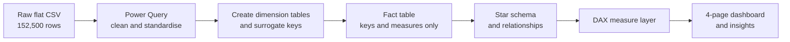
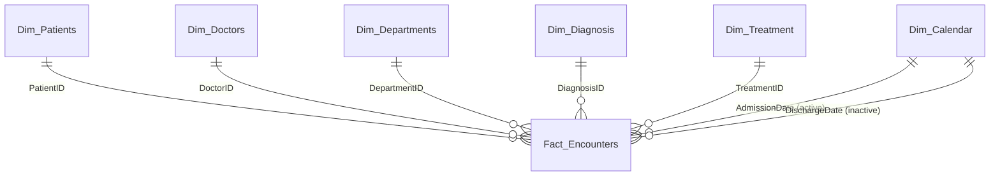

# Hospital Operations Analytics — Power BI Dashboard

An end-to-end analytics project that turns a single flat export of hospital patient encounters into a cleaned star-schema data model, a DAX measure layer and a four-page interactive Power BI dashboard covering **Overview, Patients, Operations and Finances**.


---

## Table of Contents

1. [Project Overview](#1-project-overview)
2. [Business Context](#2-business-context)
3. [Dataset](#3-dataset)
4. [Tools and Skills](#4-tools-and-skills)
5. [Methodology: Steps and Analysis](#5-methodology-steps-and-analysis)
6. [Data Model](#6-data-model)
7. [DAX Measure Layer](#7-dax-measure-layer)
8. [Dashboard](#8-dashboard)
9. [Key Performance Indicators](#9-key-performance-indicators)
10. [Insights](#10-insights)
11. [Recommendations](#11-recommendations)
12. [Limitations and Assumptions](#12-limitations-and-assumptions)
13. [Repository Structure](#13-repository-structure)

---

## 1. Project Overview

| | |
|---|---|
| **Objective** | Discover which KPIs and patterns matter to hospital management from one historical flat export of patient encounters. No KPIs were specified in advance. |
| **Input** | One CSV file: 152,500 rows and 18 columns, one row per patient encounter. |
| **Output** | A cleaned star schema, a dedicated Date table, a DAX measure layer, a four-page dashboard and this documentation. |
| **Period covered** | Admissions from 1 January 2022 to 31 December 2025. Discharges extend to 10 January 2026. |
| **Currency** | Nigerian Naira (₦) |

**Scope of deliverables**

- Power Query cleaning and transformation workflow
- Dimensional model (fact table and dimension tables) with design justification
- Dedicated Date table (Auto date/time not used)
- Role-playing dates (`AdmissionDate` active, `DischargeDate` inactive) using `USERELATIONSHIP`
- DAX measures, including time intelligence (YTD, prior year, YoY)
- Four-page dashboard, insight summary and documentation

---

## 2. Business Context

Hospital management needs to understand how the facility is used, how long patients stay, who they are, and how much revenue is billed versus collected. The hospital supplied one historical export and **did not define the KPIs**, so the first task was to formulate and test the right questions.

**Business questions investigated**

| Area | Question |
|---|---|
| Demand | Which departments carry the most encounters, and is demand seasonal or growing? |
| Patients | Who are the patients (age, gender, insurance) and how often do they return? |
| Operations | How long do patients stay, by department? Is the hospital busier on weekdays than weekends? |
| Clinical outcomes | How many encounters end in discharge versus follow-up, transfer or referral? |
| Finance | How much is billed, collected and still owed? Which departments and treatments generate the most revenue, and the highest bill per encounter? |

**Intended audience:** hospital management, operations planners and finance or billing teams.

---

## 3. Dataset

**Source:** a single flat CSV export of patient encounters (`Hospital_Encounters_Raw.csv`) supplied with the project brief. Patient and doctor names in the source were placeholder codes (for example `Patient 00001`, `Dr. A01`); they were replaced with fictitious names for presentation. Any resemblance to real persons is coincidental.


### 3.1 Column dictionary

| Column | Type (after cleaning) | Description |
|---|---|---|
| `EncounterID` | Text | Unique identifier of one patient encounter (the **grain** of the fact table) |
| `PatientID` | Text | Unique patient identifier |
| `PatientName` | Text | Patient name (fictitious) |
| `Gender` | Text | Male / Female |
| `DateOfBirth` | Date | Patient date of birth |
| `InsuranceType` | Text | HMO, Private, Self-Pay, NHIS |
| `Department` | Text | Department where the encounter took place |
| `Doctor` | Text | Treating doctor |
| `Specialty` | Text | Doctor's specialty |
| `Diagnosis` | Text | Specific diagnosis |
| `DiagnosisGroup` | Text | Diagnosis category (for example Infectious, Chronic) |
| `Treatment` | Text | Treatment type |
| `AdmissionDate` | Date | Date the patient was admitted |
| `DischargeDate` | Date | Date the patient was discharged |
| `LengthOfStay` | Whole number | Days between admission and discharge |
| `BillingAmount` | Decimal | Amount billed for the encounter (₦) |
| `PaymentStatus` | Text | Paid, Partially Paid, Outstanding |
| `Outcome` | Text | Discharged, Follow-up Required, Transferred, Referred |

### 3.2 Data quality issues found and how each was handled

Row counts are from the raw 152,500-row file.

| # | Issue | Column(s) | Rows affected | Treatment |
|---|---|---|---|---|
| 1 | Exact duplicate rows | All | 2,500 | Removed, so `EncounterID` is unique (150,000 rows) |
| 2 | Blank doctor | `Doctor` | 306 | Rows removed from the fact table because a foreign key such as `DoctorID` cannot be NULL |
| 3 | Inconsistent capitalisation | `Gender` | 306 | Standardised to Male / Female |
| 4 | Leading/trailing spaces and mixed case | `Department` | 6,998 (33 spellings for 10 departments) | Trim and Capitalize Each Word |
| 5 | Blank values and a duplicate label | `InsuranceType` | 410 blank, 308 "Private Insurance" | "Private Insurance" merged into "Private"; blanks labelled "Unknown" |
| 6 | Blank values and mixed case | `PaymentStatus` | 504 blank, 404 case variants | Standardised case; blanks labelled "Unknown" |
| 7 | Blank values | `Outcome` | 355 | Labelled "Unknown" |
| 8 | Inconsistent capitalisation and blanks | `DiagnosisGroup` | 258 blank | Capitalisation standardised; descriptive attribute only, no key impact |

---

## 4. Tools and Skills

| Tool | Used for |
|---|---|
| Power BI Desktop | Modelling, DAX and report design |
| Power Query (M) | Cleaning, transformation, dimension and key creation |
| DAX | Measures, time intelligence, role-playing dates |
| Excel / CSV | Inspecting the raw export |
| GitHub | Version control and documentation |

---

## 5. Methodology: Steps and Analysis



### Workflow

1. **Clean the flat table.** Profile every column, fix types, trim text, standardise case, handle blanks and remove duplicate rows (see [3.2](#32-data-quality-issues-found-and-how-each-was-handled)).
2. **Duplicate the cleaned table and create dimension tables.** One duplicate of the flat table per dimension (Patients, Doctors, Departments, Diagnosis, Treatment). Keep only that dimension's descriptive columns.
3. **Merge each dimension table into the fact table** to insert its **surrogate key** (for example, `DoctorID`, `DepartmentID`).
4. **Remove the null-doctor rows from the fact table** (306 rows), because the `DoctorID` key cannot contain NULLs.
5. **Remove the descriptive columns from the fact table.** Names, departments, diagnoses and similar text now live in the dimension tables, so the fact table keeps only keys, dates and numeric measures.
6. **Remove duplicates** so that each dimension has one row per member and every key is unique.
7. **Create the Date table** (`Dim_Calendar`), 1 January 2022 to 31 December 2026, and mark it as the date table.
8. **Create the relationships using the keys.**
9. **Model the role-playing dates:** an **active** relationship from `Dim_Calendar[Date]` to `AdmissionDate`, and an **inactive** relationship to `DischargeDate`, activated with `USERELATIONSHIP`.
10. **Calculate measures using DAX,** then explore the data, decide what belongs on the dashboard and build the four pages.

### 5.1 Power Query


### 5.2 Determining the grain

**One row = one patient encounter, identified by `EncounterID`.** Each patient has between 7 and 37 encounters (average 18.71), so `PatientID` is not unique in the fact table, and the model was built around the encounter. After de-duplication, `EncounterID` is unique.

---

## 6. Data Model

A **star schema** was chosen: one central fact table of encounters surrounded by small, single-purpose dimension tables.




### 6.1 Tables

| Table | Type | Grain (one row per…) | Key |
|---|---|---|---|
| `Fact_Encounters` | Fact | Patient encounter | `EncounterID` |
| `Dim_Patients` | Dimension | Patient | `PatientID` |
| `Dim_Doctors` | Dimension | Doctor | `DoctorID` |
| `Dim_Departments` | Dimension | Department | `DepartmentID` |
| `Dim_Diagnosis` | Dimension | Diagnosis | `DiagnosisID` |
| `Dim_Treatment` | Dimension | Treatment | `TreatmentID` |
| `Dim_Calendar` | Dimension (Date) | Calendar day | `Date` |
| `_Measures` | Measure table | n/a | n/a |

### 6.2 Why a star schema

- **Smaller and faster.** Text such as department and diagnosis names is stored once in a dimension instead of being repeated across 150,000 rows.
- **Simple, predictable filtering.** Every relationship is one-to-many from a dimension to the fact table, so slicers filter the fact table in one direction with no ambiguity.
- **One place to fix each attribute.** A correction to a department name is made once.
- **Natural fit for role-playing dates.** One Date table serves two date columns in the fact table.

### 6.3 Date table

`Dim_Calendar` was built in Power Query as a list of dates from 1 January 2022 to 31 December 2026 (1,826 days) and marked as the date table. The range extends past the last admission (31 December 2025) so that discharges in January 2026 still match a date.

| Column | Example | Purpose |
|---|---|---|
| `Date` | 2024-03-15 | Key |
| `Year` | 2024 | Year slicer and YoY |
| `Quarter` | Q1 | Quarterly analysis |
| `MonthNumber` / `MonthName` | 3 / March | Month labels (sorted by number) |
| `YearMonth` / `YearMonthNumber` | 2024-03 / 202403 | Chronological month axis |
| `DayOfWeekNumber` / `DayName` | 5 / Friday | Day-of-week analysis (sorted by number) |
| `WeekdayWeekend` | Weekday | Weekday versus weekend comparison |


### 6.4 Role-playing dates

| Relationship | Fact column | State | Used by |
|---|---|---|---|
| `Dim_Calendar[Date]` → | `AdmissionDate` | **Active** | All default measures and visuals |
| `Dim_Calendar[Date]` → | `DischargeDate` | **Inactive** | Discharge-based measures through `USERELATIONSHIP` |


---

## 7. DAX Measure Layer

All measures are stored in the `_Measures` table.


### 7.1 Core measures

```DAX
Total Patients = DISTINCTCOUNT ( Fact_Encounters[PatientID] )

Total Encounters = COUNTROWS ( Fact_Encounters )

Total Billings = SUM ( Fact_Encounters[BillingAmount] )

Average Bill = AVERAGE ( Fact_Encounters[BillingAmount] )

Average LOS = AVERAGE ( Fact_Encounters[LengthOfStay] )

Avg Encounters per Patient = DIVIDE ( [Total Encounters], [Total Patients] )

Avg Patient Age = AVERAGE ( Dim_Patients[Age] )

Avg Encounters per Day = DIVIDE ( [Total Encounters], COUNTROWS ( Dim_Calendar ) )
```

### 7.2 Clinical and financial measures

```DAX
Follow-up Required Encounters =
CALCULATE (
    COUNTROWS ( Fact_Encounters ),
    Fact_Encounters[Outcome] = "Follow-up Required"
)

Follow-up Rate % =
DIVIDE ( [Follow-up Required Encounters], [Total Encounters] )

Total Amount Paid =
CALCULATE ( [Total Billings], Fact_Encounters[PaymentStatus] = "Paid" )

Total Outstanding Amount =
CALCULATE ( [Total Billings], Fact_Encounters[PaymentStatus] = "Outstanding" )
```

### 7.3 Role-playing dates (`USERELATIONSHIP`)

```DAX
Admissions = COUNTROWS ( Fact_Encounters )

Discharges =
CALCULATE (
    COUNTROWS ( Fact_Encounters ),
    USERELATIONSHIP ( Dim_Calendar[Date], Fact_Encounters[DischargeDate] )
)
```

### 7.4 Time intelligence

```DAX
Encounter YTD =
TOTALYTD ( [Total Encounters], Dim_Calendar[Date] )

Encounter YTD SPLY =
CALCULATE ( [Encounter YTD], SAMEPERIODLASTYEAR ( Dim_Calendar[Date] ) )

Encounter YoY % =
VAR Curr = [Encounter YTD]
VAR Prev = [Encounter YTD SPLY]
RETURN
    IF ( ISBLANK ( Curr ) || ISBLANK ( Prev ), BLANK (), DIVIDE ( Curr - Prev, Prev ) )
```

The `IF ( ISBLANK … )` guard returns blank, instead of -100%, for periods with no data such as 2026.

---

## 8. Dashboard

The report uses one consistent layout: a title bar, a left navigation panel with page buttons, slicers (**Year, Gender, Department**) that apply across pages, KPI cards at the top and supporting visuals below. The active page's button is highlighted.

### 8.1 Overview


| Visual | Purpose |
|---|---|
| KPI cards: Total Patients, Total Encounters, Total Billings, Average Bill, Average LOS | Headline performance |
| Encounters by Department | Where demand sits |
| Patients by AgeGroup | Patient age profile |
| Encounters by Outcome | Share of discharges, follow-ups, transfers and referrals |
| Encounters Over Time (Year Month) | Trend and seasonality |

### 8.2 Patients


| Visual | Purpose |
|---|---|
| KPI cards: Total Patients, Avg Patient's Age, Avg Encounters per Patient, Follow-up Rate | Patient profile and repeat use |
| Patients by Insurance Type | Payer mix |
| Gender Distribution | Gender balance |
| Patients by AgeGroup | Age bands |
| Encounters by Treatment | Service mix |
| Encounters by Diagnosis Group | Case mix |

### 8.3 Operations


| Visual | Purpose |
|---|---|
| KPI cards: Total Encounters, Avg Encounters per Patient, Average LOS, Avg Encounters per Day | Workload and throughput |
| Average Daily Encounters by Department | Daily load per department |
| Weekend vs Weekday Encounters | Weekly demand pattern |
| Encounter Time Series Analysis (YTD, SPLY, YoY %) | Time intelligence |
| Encounters by Doctor's Specialty | Specialty workload |
| Average LOS by Department | Bed-days intensity by department |

### 8.4 Finances


| Visual | Purpose |
|---|---|
| KPI cards: Total Billings, Average Billing Amount, Total Amount Paid, Total Outstanding Amount | Billing and collection position |
| Total Bill by Department | Cost per department |
| Total Bill by Payment Status | Paid, partly paid and outstanding amounts |
| Total Billings by Insurance Type | Revenue by payer |
| Total Billings Over Time (Years) | Revenue trend |
| Average Bill by Department | Cost per services |

---

## 9. Key Performance Indicators

| KPI | Value | Definition |
|---|---:|---|
| Total Patients | **8,000** | Distinct patients |
| Total Encounters | **150,000** | Number of patient encounters |
| Total Billings | **₦7.54bn** | Sum of billed amounts |
| Average Bill | **₦50.71K** | Mean billed amount per encounter |
| Average Length of Stay | **3.16 days** | Mean of `LengthOfStay` |
| Average Patient Age | **45 years** | Mean age of patients |
| Average Encounters per Patient | **18.71** | Total encounters ÷ total patients |
| Follow-up Rate | **14.95%** | Encounters with outcome "Follow-up Required" ÷ all encounters |
| Average Encounters per Day | **81.98** | Total encounters ÷ number of days in the Date table |
| Total Amount Paid | **₦5.28bn** | Billings with status "Paid" |
| Total Outstanding Amount | **₦895.88M** | Billings with status "Outstanding" |

---

## 10. Insights

### Demand and volume

1. **Outpatient has the highest number of encounters (about 33K), followed by Emergency (about 24K).** Together they account for roughly 38% of all encounters. Average daily encounters are **17.9** for Outpatient and **13.2** for Emergency.
2. **Average weekday and weekend encounters per day are almost balanced,** so demand does not drop at weekends.
3. **The hospital sees a drop in encounters every February, with the lowest in February 2022,** and high numbers in **August and January, with the peak in August 2023.**
4. **Volume and revenue are flat year on year.** YoY encounter change is +0.68% (2023), -0.14% (2024) and -0.77% (2025), and annual billings stay between ₦1.88bn and ₦1.90bn.

### Patients

5. **Middle-aged patients (40 to 64) are the largest group (about 2.5K),** followed by adults (18 to 39, about 2.2K) and seniors (65+, about 2.0K). Children (1 to 17) are far fewer (about 1.2K).
6. **Male and female patients are nearly balanced** (53.2% female, 46.8% male).
7. **Most patients use HMO, followed by Private,** then Self-Pay and NHIS.
8. **Every patient is a repeat patient.** Each has between 7 and 37 encounters (average 18.71), pointing to a population with ongoing or chronic care needs.
9. **The most frequent diagnosis groups are Infectious, Chronic and Respiratory,** together about half of all encounters. **Blood and Cardiovascular are the least frequent.**

### Clinical operations

10. **A very high number of encounters end in discharge, about 108,000 (around 72%).** The follow-up rate is 14.95%; the remainder are transfers and referrals.
11. **General Surgery patients tend to stay longest, with an average length of stay of 7.0 days,** followed by Orthopedics and Cardiology (5.0 days each). Outpatient is shortest (0.8 days). The hospital average is 3.16 days.
12. **General Surgery uses far more beds than its volume suggests:** about 8% of encounters but about 18% of bed-days.
13. **About 21% of encounters are same-day** (length of stay of 0 days).

### Financial

14. **General Surgery has the highest average bill and Outpatient the lowest.** By treatment, Critical Care, Surgery and Delivery have the highest average bills.
15. **Average bill per department is not proportional to revenue contribution.** Outpatient has the lowest average bill but brings in the second-highest revenue (₦1.13bn), behind Emergency (₦1.21bn), because of its volume.
16. **The hospital has a significantly higher ratio of paid bills than outstanding and debts:** ₦5.28bn paid against ₦895.88M outstanding. Partially paid bills add a further ₦1.34bn that is not yet fully collected.

---

## 11. Recommendations

These are analyst recommendations based on the dataset and should be validated against operational constraints.

| # | Recommendation | Supported by |
|---|---|---|
| 1 | **Plan capacity and staffing around Outpatient and Emergency,** which carry the largest daily load (17.9 and 13.2 encounters a day). | Insight 1 |
| 2 | **Keep a flat weekly staffing pattern.** Weekday and weekend volumes are almost balanced, so weekend cover should not be reduced on volume grounds. | Insight 2 |
| 3 | **Review General Surgery discharge planning and bed management.** It consumes about 18% of bed-days from about 8% of encounters; cutting the average stay by one day would free about 12,000 bed-days over the four years. | Insights 11, 12 |
| 4 | **Focus collections on partially paid and outstanding bills (about ₦2.23bn combined).** Start with the insurance groups holding the largest outstanding balances. | Insight 16 |
| 5 | **Protect Outpatient throughput and look for added-value services.** It is the highest-volume department with the lowest bill per encounter, so small improvements in billing capture scale quickly. | Insights 14, 15 |
| 6 | **Prepare for the August and January peaks** with leave scheduling and supply planning, and plan lighter cover for February. | Insight 3 |
| 7 | **Resource follow-up care.** About 15% of encounters (around 22,400) require follow-up, which needs scheduling and clinic capacity. | Insight 10 |
| 8 | **Set growth goals.** Volume and revenue are flat (changes below 1% a year), so growth would need new services, capacity or referral channels. | Insight 4 |

---

## 12. Limitations and Assumptions

- **Exercise dataset.** The data was supplied for a portfolio project, so the findings demonstrate the analytical method and are not evidence about a real hospital.
- **Removed rows.** 2,500 duplicate rows and 306 blank-doctor rows were removed. Billing associated with the removed rows is excluded from all totals.
- **Billing blanks.** Some encounters have no billing amount. They are excluded from the average bill, so `Average Bill × Total Encounters` does not equal `Total Billings`.
- **Partially paid bills.** The unpaid portion of partially paid bills is not recorded, so true outstanding debt is higher than the "Outstanding" figure.
- **Patient age is current age,** calculated as of the report refresh date, not at the time of each encounter.
- **Date range.** Admissions end on 31 December 2025. The 2026 rows are discharges only, so 2026 is excluded from year-on-year comparisons.
- **Same-day stays.** A length of stay of 0 is treated as a valid same-day discharge, not an error.
- **No cost data.** The dataset has billings but no cost of care, so profitability cannot be assessed.
- **Follow-up Rate** is based on the "Follow-up Required" outcome label only; no readmission dates are available.

---

## 13. Repository Structure

```text
.
├── README.md
├── data/
│   └── Hospital_Encounters_Raw.csv
├── powerbi/
│   └── Healthcare Analytics Project_Power BI.pbix
├── docs/
│   └── PROJECT_BRIEF.docx
└── images/
    ├── 01_dashboard_overview.png
    ├── 02_dashboard_patients.png
    ├── 03_dashboard_operations.png
    ├── 04_dashboard_finances.png
    ├── 05_raw_data_preview.png
    ├── 06_pq_queries_pane.png
    ├── 07_pq_fact_applied_steps.png
    ├── 08_pq_dimension_tables.png
    ├── 09_pq_data_quality_profile.png
    ├── 10_data_model.png
    ├── 11_date_table.png
    ├── 12_relationships_active_inactive.png
    ├── 13_dax_measures.png
    └── 14_dax_time_intelligence.png
```

---

*Feedback and suggestions are welcome through GitHub Issues.*
